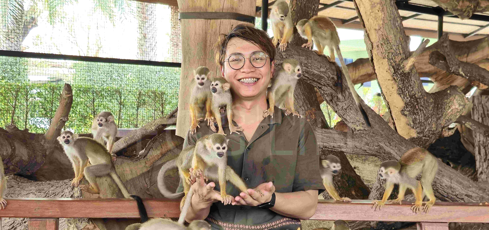

林良亘(ㄒㄩㄢ)，綽號阿蛋，因為「亘」有邊念邊、無邊隨「旦」字唸的關係，從國小就被大家叫阿蛋。

故本站的主軸用「蛋」代表自己。每個動作都有些特別的意義可以思考，有興趣可以透過轉動、觀察和探索，慢慢認識這顆蛋。

## 能做什麼、希望往哪裡發展
先看清楚問題，再一步一步想辦法解決。從水電、通訊到廠務工作的經驗，讓我學會觀察現場，也累積了動手處理事情的基礎。

現在，開始和 AI 協作，嘗試把腦中的想法做成可以使用的工具。未來希望繼續結合實務經驗與數位工具，透過作品和交流累積能力，慢慢走向遠端工作的生活。

## 萬事萬物都在變化,唯一不變的是改變的本身

在數位技術與 AI 浪潮快速迭代的時代，這句話視為自己的核心信念。「改變」不是不確定性，而是探索自我的機會。 跳脫舒適圈、擁抱新科技，並接受任何變化，將自己定位為一個「持續學習的體驗者」。生成式 AI 工具的導入，與每一次接觸不同新領域的挑戰，透過動手實作，將未知的變化轉化為實質的生產力。發現出更多元的自己並允許一切事物的發生，不被既有框架所束縛，才有進化的可能。

