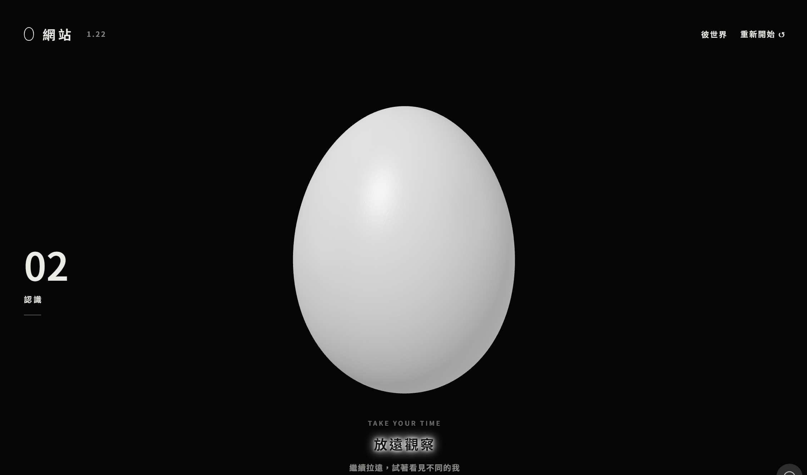

# 讓每一個想法與解法，慢慢誕生。 
持續調整中

有興趣請點圖片
## 01 蛋｜互動式個人網站

### 想法

用一顆蛋呈現，讓同頻的透過探索慢慢認識。

### 怎麼做

規劃六區內容與互動方式，搭配 AI 工具協作製作，並依實際操作結果反覆調整。

### 解說
一開始，只能看見的只是眼前的一小部分，不知道這是什麼。
慢慢放遠，才發現眼前是一顆蛋。
異視－換個角度觀察，會看見不同的樣子。
      用意識觀察自己，也有不一樣的發現。

認識－靠近、放下並停留，蛋殼上的文字會慢慢浮現。走進每一面，可以看見不同類別的資訊。

看過的面會留下文字該區域代表的蛋字。隨著一面一面累積，原本的黑白世界漸漸有了色彩，形成「彼界」一個可以從不同角度繼續探索的世界。

彼界－最後，你可以選擇打開蛋殼。裡面沒有任何東西，不替它安排答案；你可以自己看看，也可以蓋上蛋殼，回到那些已經認識、或想再次了解的面向。

### 目前狀態

可在電腦瀏覽器體驗；實體手機操作仍待測試。

## 02 泣嘎週烘焙訪

課堂／個人 Demo

### 想法

這網頁是一款餐飲新人 AI 情境訓練遊戲，以虛構品牌「泣嘎週烘焙訪」為示範。

想解決的問題是：新人看過 SOP，遇到客人時，仍可能不知道怎麼問、怎麼回答，以及何時需要求助。

員工透過手機版畫面接待模擬客人，從選項中選擇回覆，再依客人的反應繼續處理。訓練包含需求確認、選品、特殊飲食需求、製作協助與離店說明。

AI 的用途是變換客人的說法、語氣及追問，並根據練習紀錄提供回饋，減少單純背答案的情況。品牌規定與訓練目標則維持固定。

**預期價值：**讓新人先有練習機會，也協助店長找到需要補強的地方。是否能縮短帶教時間、改善服務表現，仍需實際試用驗證。
### 目前狀態
目前是 1.4 版功能原型，尚未達到正式企業上線程度。
項目	目前進度
訓練內容	已編寫七天、十四個固定劇本，包含補問、修正與完成回顧
員工與店長	已有示範登入、練習進度、店長摘要與現場觀察紀錄
Gemini 串接	已加入金鑰設定、連線測試、AI 客人、個別回饋及語音程式
實際驗證	前版本已驗證固定劇本主要流程；1.4 已做語法與模擬流程檢查，尚未確認真實 Gemini 呼叫成功
資料保存	儲存在同一瀏覽器，尚無跨裝置同步或正式帳號權限
內容依據	使用虛構 SOP，尚未經實際品牌審核

**現階段適合拿來展示訓練方式、蒐集企業意見。**下一步最重要的是確認 Gemini 實際可用，再邀請新人與店長試玩，觀察情境是否貼近現場、回饋是否有幫助。

## 03 客戶AI問答小幫手

課堂／個人 Demo

### 想法
因為觀察後發現，顧客在找材料及一些製作步驟會卡住停下來詢問店員，讓簡單的回覆不再尋找店員處理，讓建好的數據庫回答就好所以打造「掃碼就能使用的 DIY 烘焙門市助手」，協助顧客找材料、查器具、理解製作步驟，減少等待店員及重複詢問。

透過文字與語音自由提問，讓雙手忙於製作的顧客也能獲得引導。核心價值是依門市提供的資料回答，降低拿錯材料與操作誤解的機會，並把過敏、素食及宗教飲食需求轉交店員確認。
### 目前狀態
已完成可公開使用的展示版：開啟 DIY 烘焙 AI 助手。
- **知識內容：**A～Z 共 260 項位置清單、六吋巧克力蛋糕示範食譜，以及飲食限制。
- **操作功能：**免登入、文字自由問答、錄音提問、自動朗讀與手動重播。
- **資料權限：**訪客只能查詢，各頁面的對話獨立，重新整理即清除。
- **驗證情況：**曾實測找物、製作步驟、飲食限制與拒答；你也已確認電腦及 iPhone 能播放聲音。
目前適合企業提案與小規模試用。語音仍是「錄音送出後回答」，尚未做到持續即時對話；音色依裝置內建語音而異。位置屬示範配置，正式導入前須核對門市資料，並補做多人使用、現場噪音及長時間穩定性測試。

## 04 PhotoPress  快速壓縮照片與圖檔

想法
PhotoPress 是一個讓使用者在手機或電腦瀏覽器中，快速壓縮照片與圖檔的工具。

主要功能包括：
- 一次選取多張照片或整個資料夾
- 調整 JPG、PNG、WebP 的壓縮品質與輸出尺寸
- 裁切、旋轉、水平翻轉
- 加入文字浮水印：文字、顏色、大小、透明度、位置與邊距
- 批次處理並下載結果
- 照片在使用者裝置內處理，不上傳伺服器
- 標示「設計製作：EGG LIN」
目前狀態
目前已完成並公開 PhotoPress 1.0 網頁版：

開啟 PhotoPress

已完成：
- 手機與電腦瀏覽器可使用
- 公開存取，使用者不需登入或付費
- PWA 支援，可加入手機主畫面使用
- 可離線載入工具介面；照片不會被離線保存
- 批次壓縮、裁切、尺寸調整、浮水印及下載功能
- 原始照片不會被修改
目前限制：
- 主要支援 JPEG、PNG、WebP 靜態圖片
- 不支援 HEIC、RAW、GIF／動畫圖片與多頁檔案
- 單張上限為 30 MB、2400 萬像素
- 大量或高解析圖片會受手機記憶體與瀏覽器能力影響
- 使用者需在關閉或重新整理頁面前下載完成的圖片
