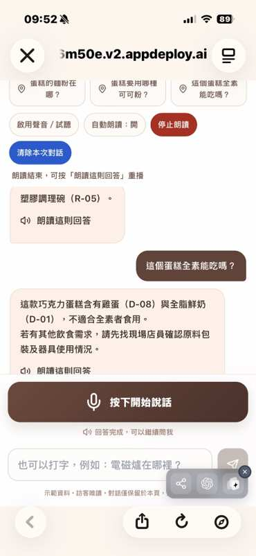
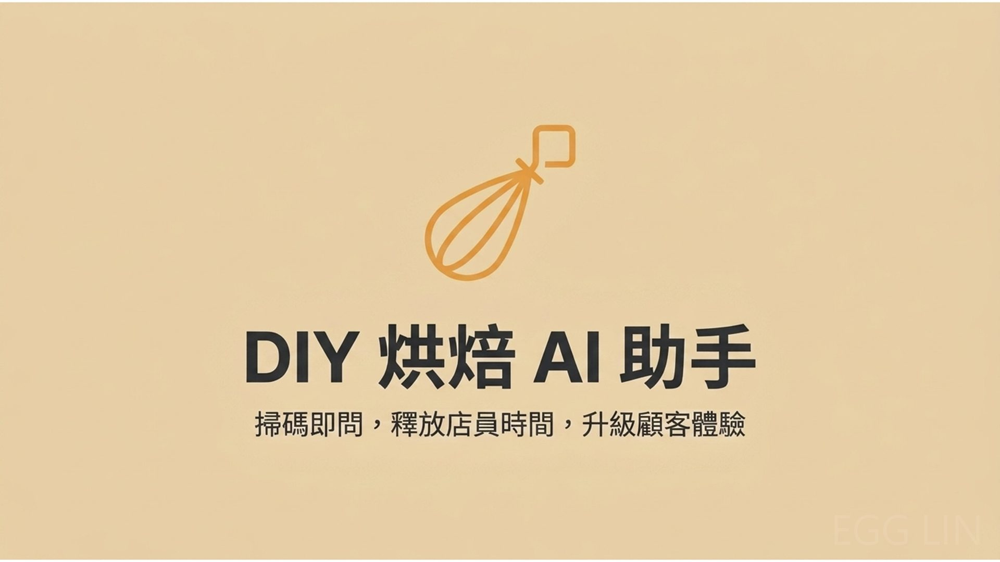
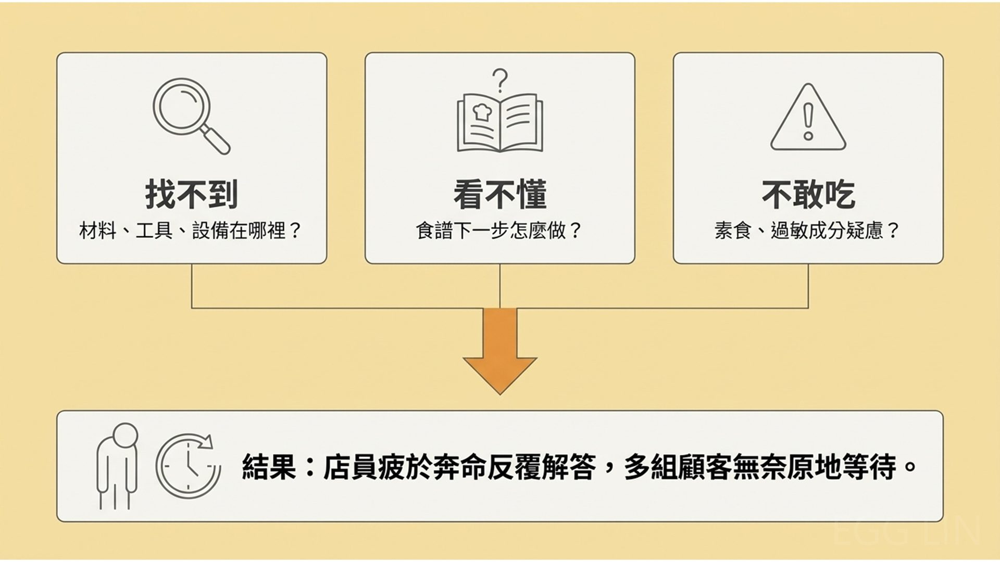
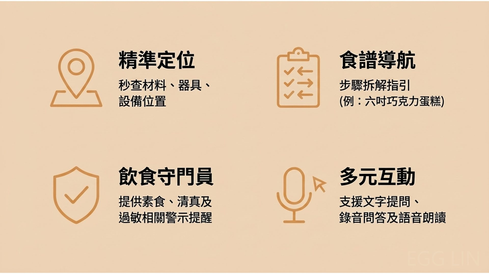
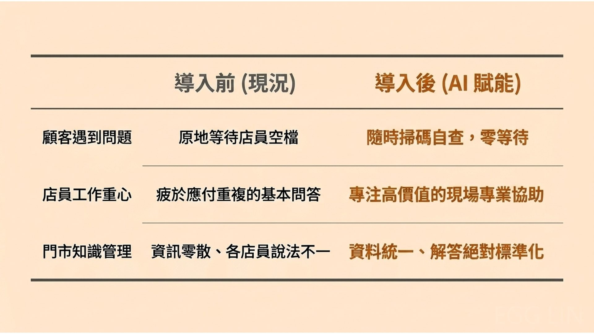
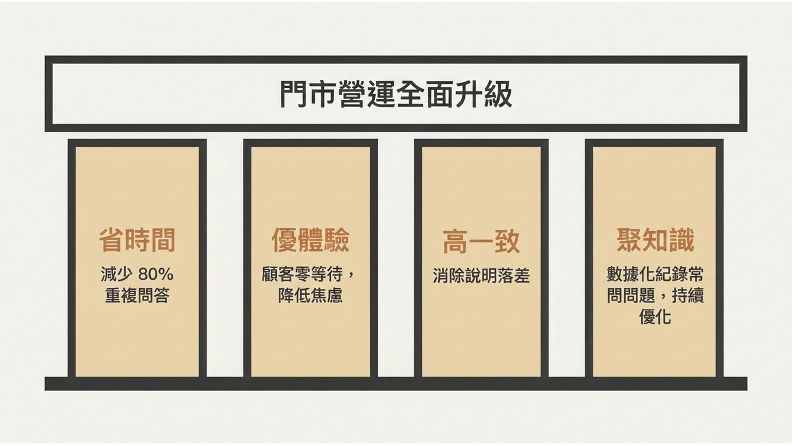
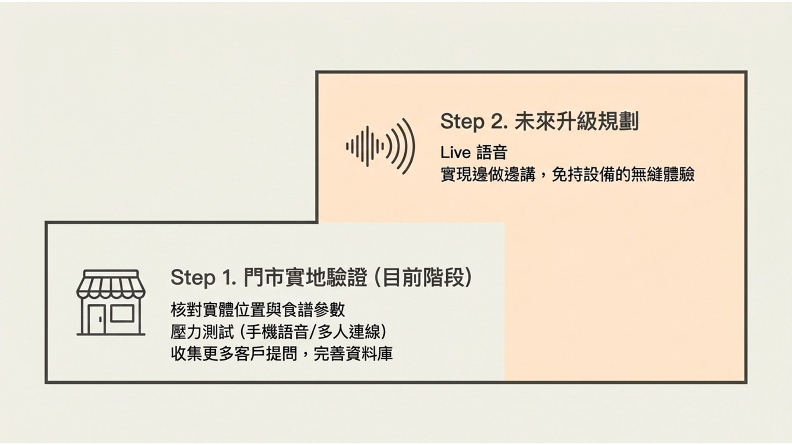
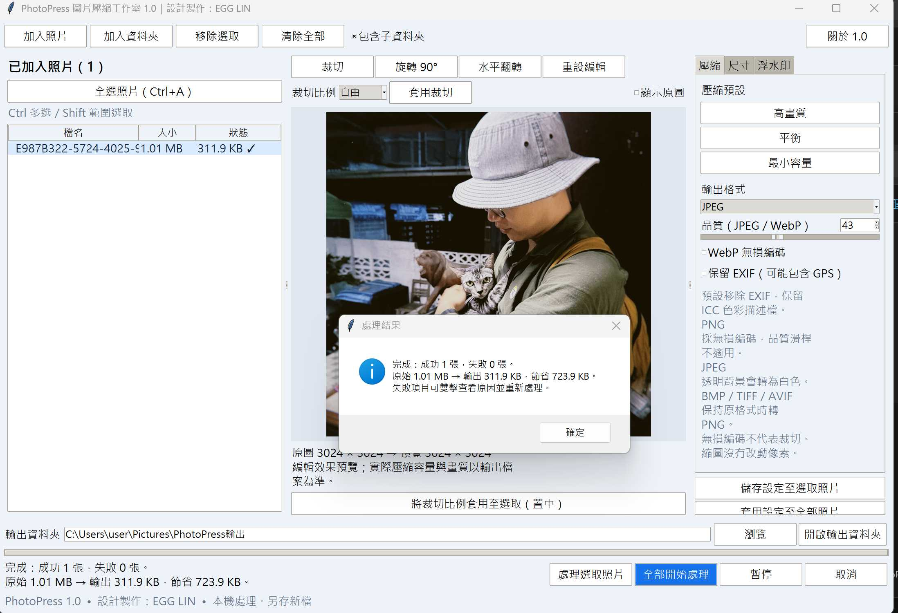

# 讓每一個想法與解法，慢慢誕生。 
持續建置調整中         有興趣請點圖片
## 01 [客戶AI問答小幫手](https://diy-ai-a6m50e.v2.appdeploy.ai/)

課堂／小組 Demo

### 介紹
在 DIY 烘焙門市，顧客常因找不到材料或不熟悉製作步驟而需要店員協助，忙碌時也可能因此等待。

我製作了 DIY 烘焙 AI 助手展示網站，讓顧客透過文字或錄音詢問材料位置與指定食譜步驟，並聆聽回答。遇到過敏、特殊飲食或資料不足的問題，助手會提醒顧客向店員確認。

這項作品希望減少門市重複問答，讓顧客更順利完成烘焙，也讓店員有更多時間提供現場協助。目前為展示版本，實際效益仍需透過門市試用驗證；地端 Live 語音則是未來規劃。

[觀看 DIY 烘焙助手Demo影片](https://youtu.be/jet5rP3XkKo)

## 02 泣嘎週烘焙坊情境訓練

課堂／個人 Demo

### 介紹

泣嘎週餐飲新人 AI 情境訓練遊戲

以虛構品牌「泣嘎週烘焙訪」為示範，讓新人透過手機接待模擬客人，練習需求確認、特殊飲食詢問、製作協助等情境，學習如何回應及何時向店長求助。AI 功能規劃用來變換客人的說法與反應，並提供個別回饋，未來加入live功能會更佳便於模擬實境演練。

目前已有七天、十四個固定劇本，以及員工練習進度和店長摘要。Gemini 串接程式已加入，可以用api測試；資料目前只保存在同一瀏覽器。

現階段適合展示訓練方式及蒐集意見。是否能縮短帶教時間、改善服務表現，仍需實際試用驗證。

## 03 PhotoPress  快速壓縮照片與圖檔

### 介紹
PhotoPress 是一款可在手機或電腦瀏覽器使用的免費圖片工具，支援批次壓縮、裁切、旋轉、調整尺寸及加入文字浮水印。照片直接在使用者的裝置內處理，不會上傳伺服器。

目前已公開 1.0 網頁版，可加入手機主畫面，並支援離線載入介面。主要適用於 JPEG、PNG 和 WebP 靜態圖片；完成的圖片需在關閉或重新整理頁面前下載。
