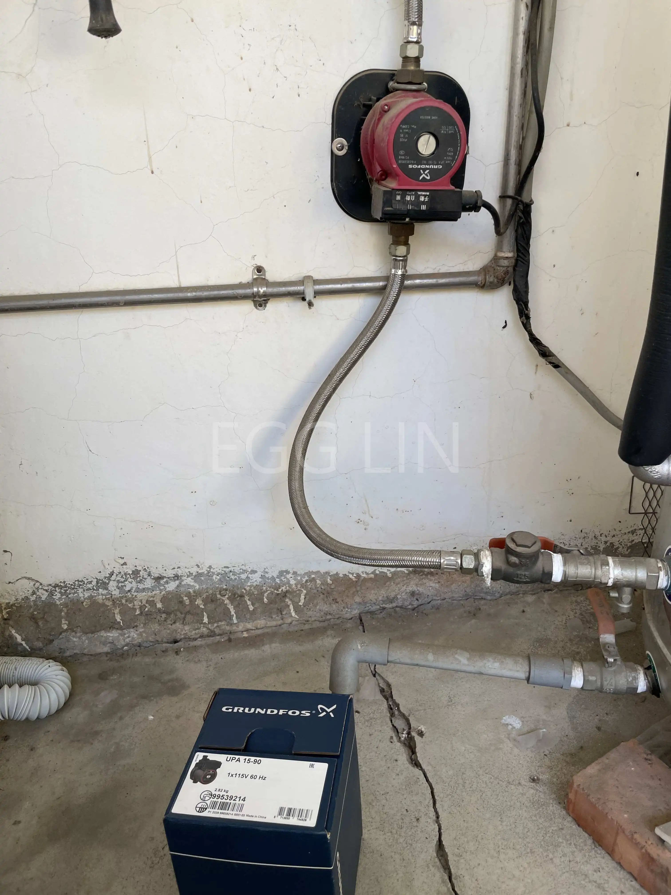
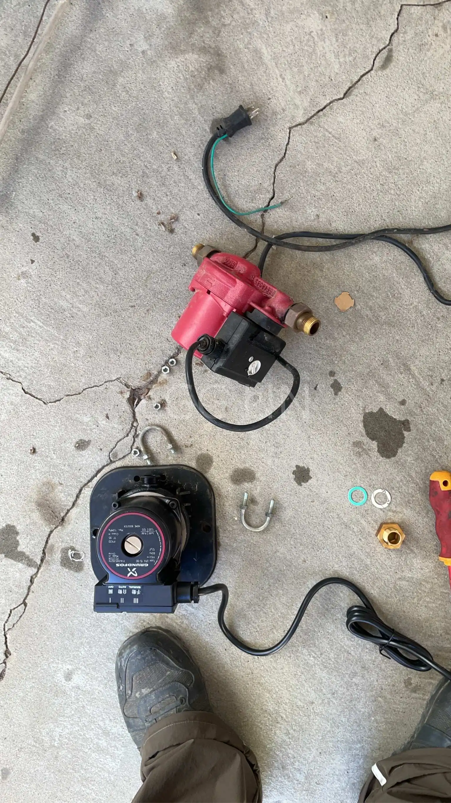
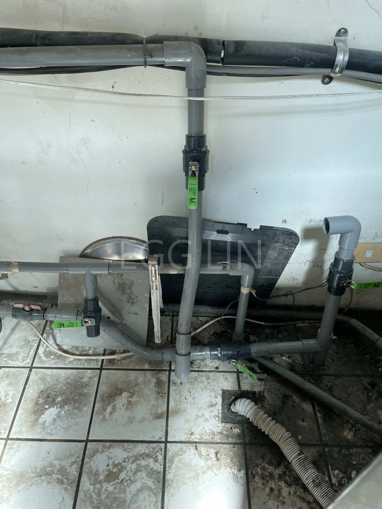
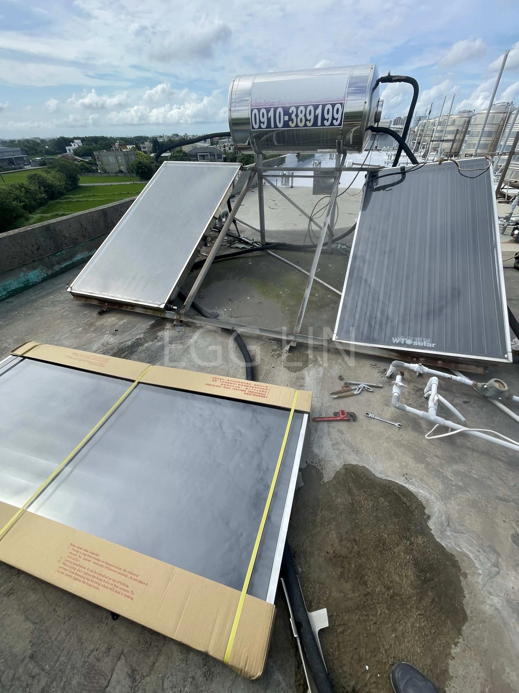
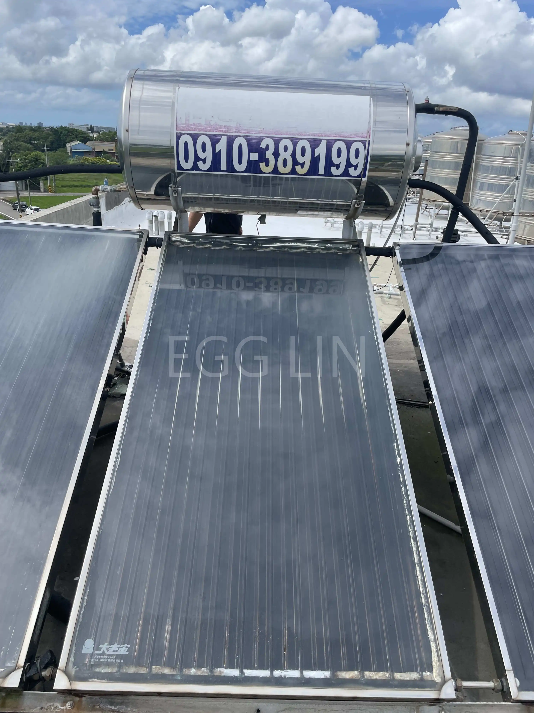
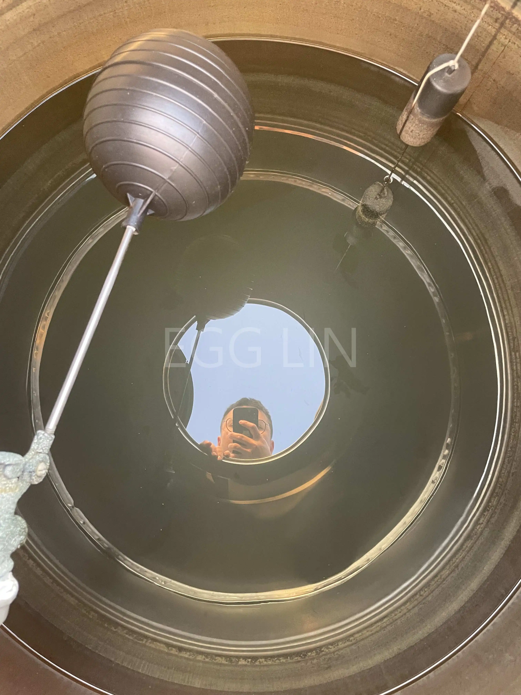
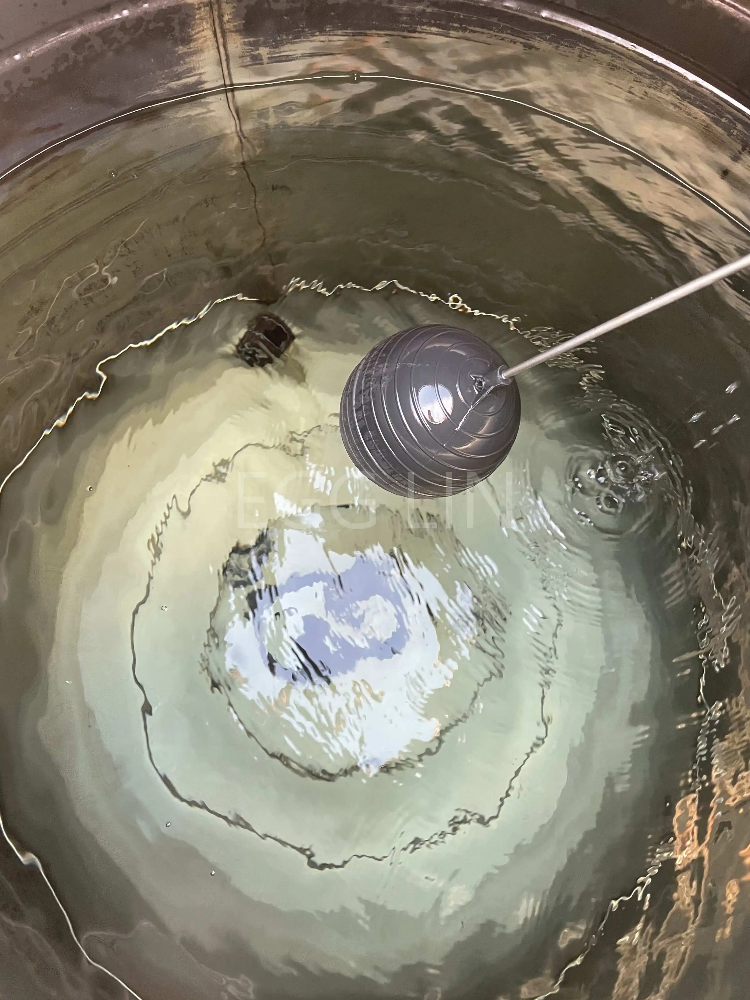
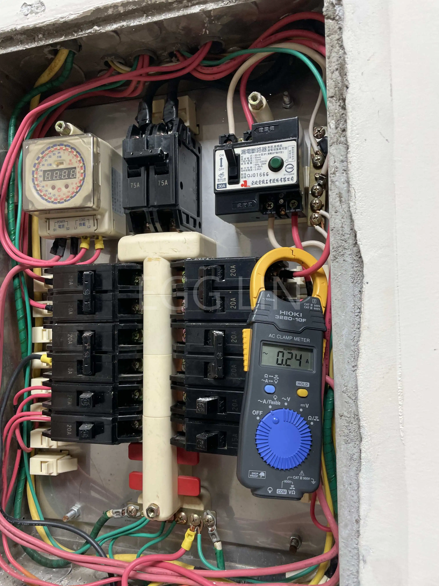
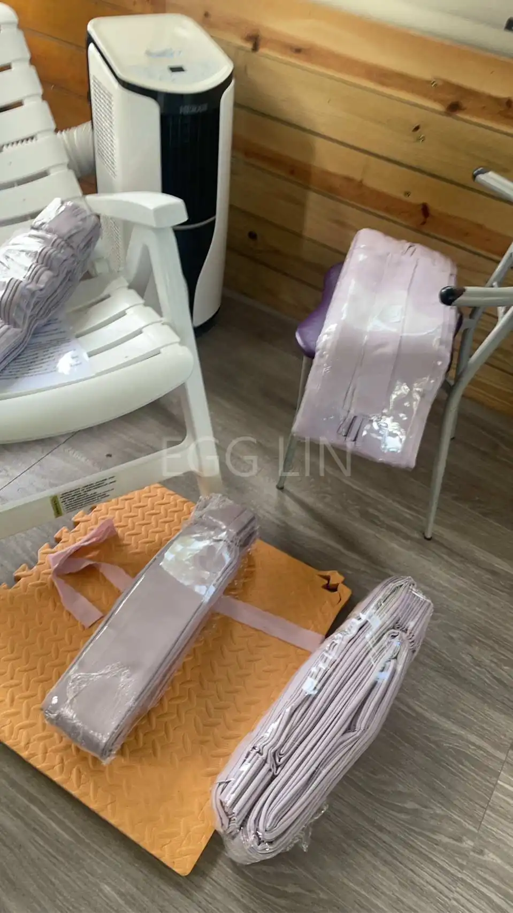
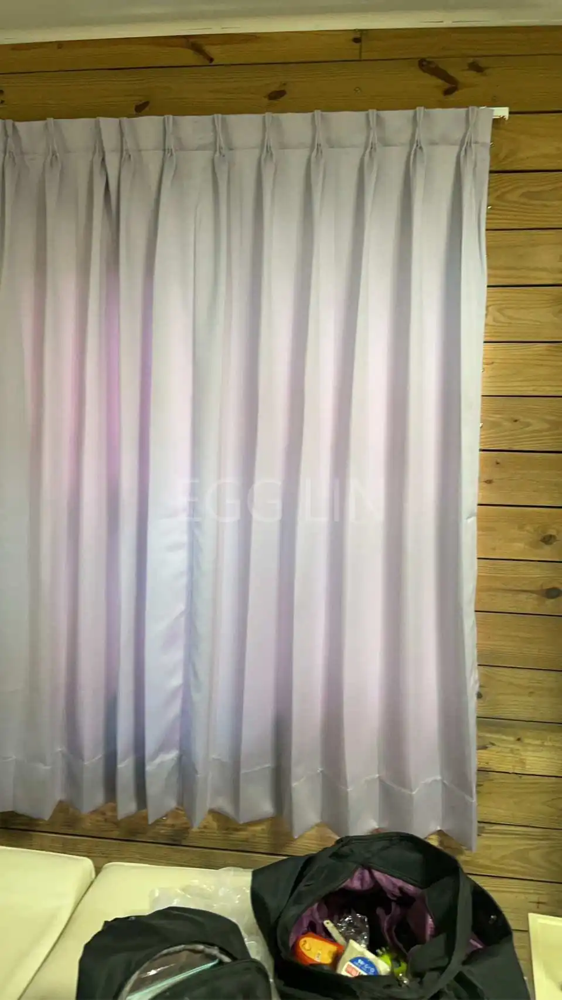

簡介：一石一石的累積

水電通有許多看不見的細節，最終希望看到的就是客戶滿足感的感覺。

# 水電實錄

## 加壓馬達更換
**狀況及處置：**客戶家中熱水器水壓變小，發現是馬達異常過熱故更換新品。

## 水管換新
**狀況及處置：**水管重接遇到需要考管技巧經驗避免斷在水泥層。

## 太陽能板更換
**狀況及處置：**客戶太陽能板用久漏水下方青苔厚厚一層，故更換新品，建議房屋定期巡視，有異就查修，避免不必要浪費。

## 水塔清洗
**狀況及處置：**客戶透天房屋水塔清洗，清洗前一定要用驗電筆查看有無漏電情形。

## 冷氣電流檢測
**狀況及處置：**檢查客戶冷氣使用狀況並計算要怎麼吹比較省。

## 窗簾安裝
**狀況及處置：**新裝設窗簾。

