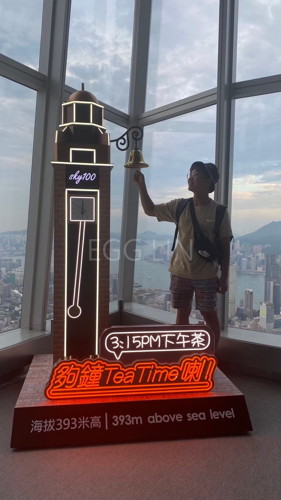
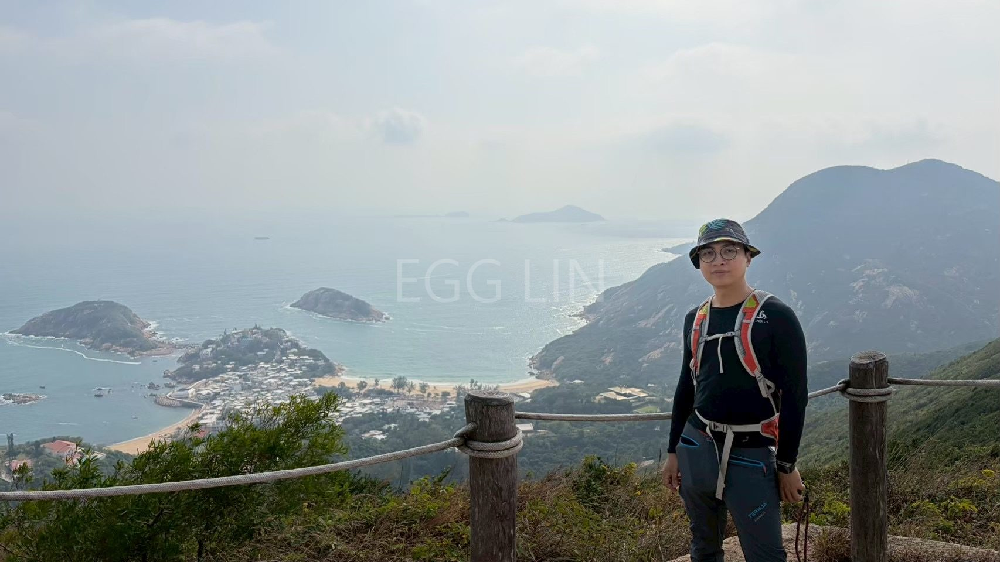
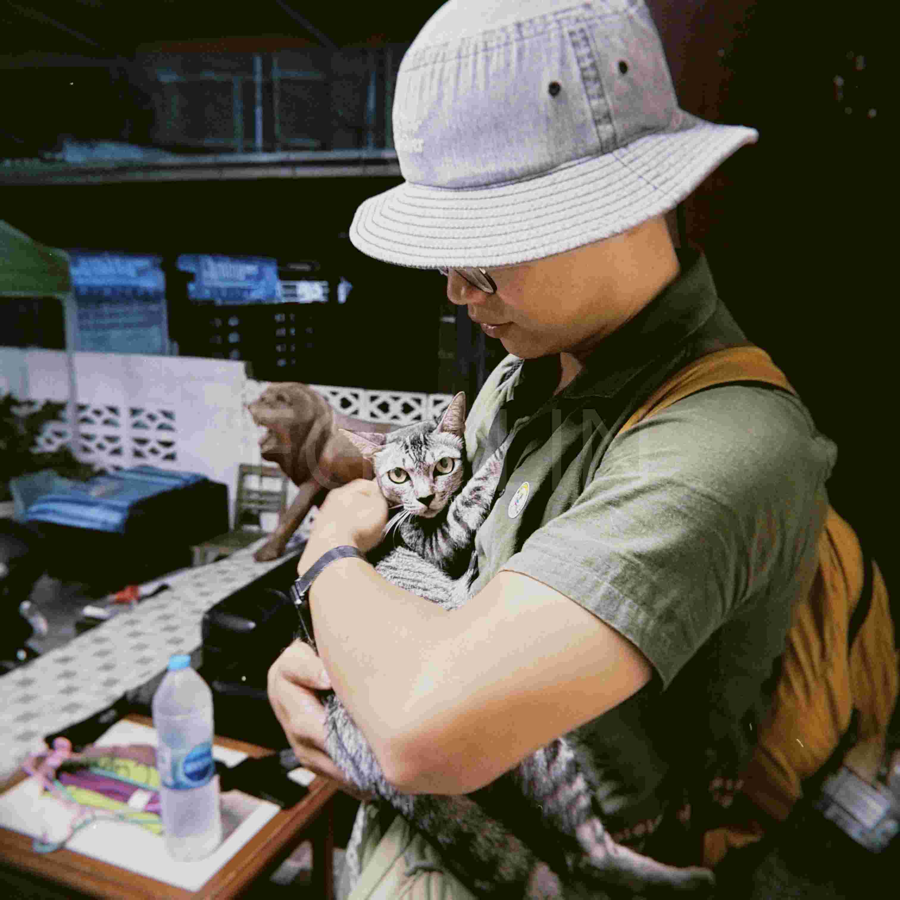
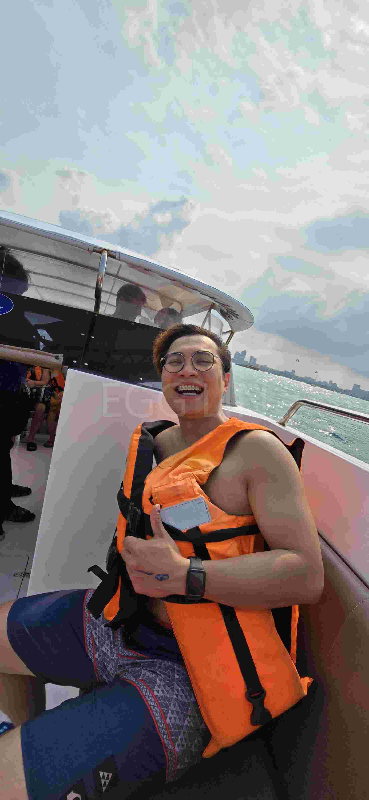
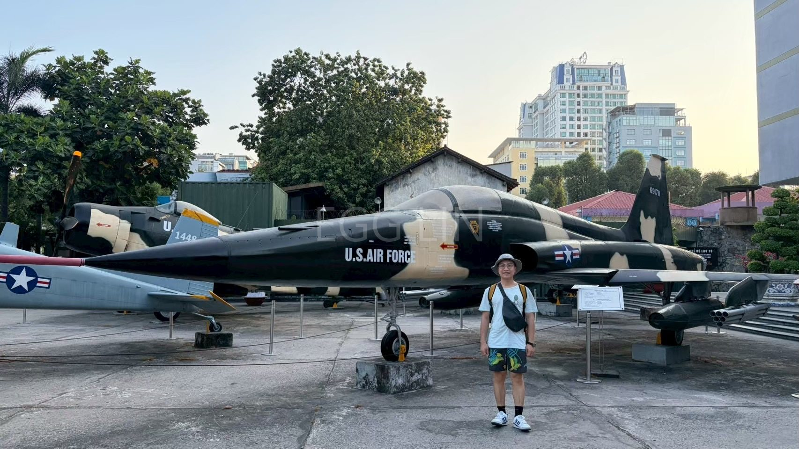
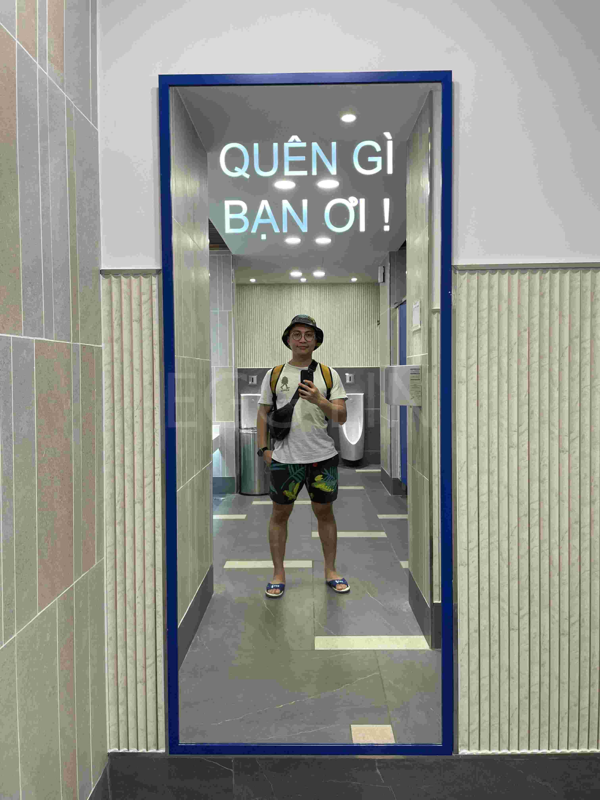

# 大餤人間
簡介：品味生活的每一刻，體驗人生，活出自己的樣子。

# 興趣
跑步、爬山、游泳，羽球；吃美食、喝茶和旅行。適時的充電與休息與刺激才能有源源不絕的精氣神，處理人的事物。

## 出國拉~屎

### 香港

拍攝地點：SKY100
時間快到嘍! 猴篩雷~

拍攝地點：龍脊步道
走在龍脊上的絕美步道，照片中往下望是石澳，健行仔沒來過絕對可惜，下山可以去石澳喝在地啤酒!CHILL~

### 泰國

拍攝地點：泰國曼谷Airbnb房東家
家貓 叫咖比 卡娃已~ 泰國曼谷貓咪超多 公園一堆!

拍攝地點：Pattaya真理聖殿
超級壯觀的純手工木雕殿，目前持續建設中，所以進去都要戴安全帽，另外要遵守相關文化習俗!

拍攝地點：前往格蘭島快艇上
遇到很nice的觀光客相互拍照留下陽光燦爛笑容

### 越南

拍攝地點：越南 戰爭遺跡博物館
展示了很多越戰武器裝備，令人訝異的是有些東西我們還在使用XDDDD

拍攝地點：某百貨男廁
穿著台灣道地藍白托逛百貨是很正常的事吧，那時都沒人快速紀錄 喀嚓! 溜~